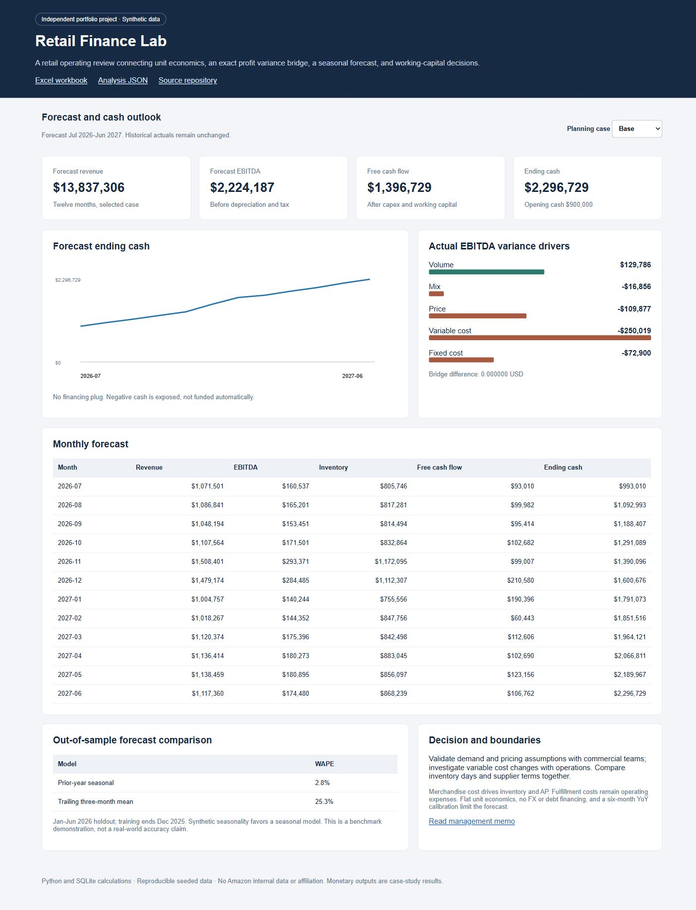

# Retail Finance Lab

A reproducible retail finance case connecting operating drivers to earnings and cash. Built as an independent portfolio project.



## Start with the decision

The retailer's EBITDA is approximately **$320,000 below budget** across the 18 actual months. The exact driver bridge separates volume, mix, price, variable cost, and fixed cost. Unit-cost pressure is the largest negative driver. A twelve-month forecast then evaluates how demand, pricing, inventory days, and supplier terms affect liquidity.

The Base scenario produces $13.84 million in modeled revenue, $2.22 million in EBITDA, and $2.30 million in ending cash. These are **simulation outputs**, not achieved revenue, savings, or an investment recommendation.

## Review in five minutes

1. Open [the Excel model](workbooks/model.xlsx). Summary shows the decision metrics; Assumptions D5 selects Base, Downside, or Upside.
2. Inspect `Variance bridge`: every dollar of EBITDA change is attributed to five mutually reconciling drivers.
3. Inspect `Forecast`: units, prices, merchandise cost, fulfillment expense, taxes, working capital, capex, and cash are linked through formulas.
4. Open `Pivot review`: a **native Excel PivotTable** summarizes category, region, revenue, and EBITDA.
5. Read [the management memo](outputs/management_memo.md) and [interview walkthrough](docs/WALKTHROUGH.md).

GitHub previews HTML as source. Download the repository and open `outputs/dashboard.html` locally, or serve it using the instructions below.

## Run

Python 3.11 or later; **no third-party Python packages** required.

```bash
python run.py
python -m unittest discover -s tests -v
python -m http.server 8000
```

Open `http://localhost:8000/outputs/dashboard.html`. The dashboard is self-contained and also works as a local HTML file. Case selection changes the forecast chart, metrics, and monthly table together. No API keys, external assets, telemetry, or network data sources are required.

`python run.py` regenerates the seeded CSVs, SQLite database, analysis JSON, forecast CSVs, management memo, and dashboard. The checked-in XLSX is a formula-based companion for the same default dataset; it recalculates scenarios in Excel. Rerunning Python does **not** silently refresh workbook source cells after code/data changes. Use the refresh procedure in [the workbook guide](docs/WORKBOOK.md).

## Data and model

| Component | Implementation |
|---|---|
| Historical case | Jan 2025-Jun 2026; 3 regions, 3 categories, 162 segment-months |
| Source records | 3,240 deterministic synthetic order records, seed 42 |
| SQL layer | Unique order keys, positive quantity constraints, segment and monthly aggregation views |
| Profit bridge | Exact sequential volume/mix/net-price/variable-cost/fixed-cost decomposition |
| Forecast | Jul 2026-Jun 2027; prior-year monthly units calibrated by trailing six-month YoY growth |
| Cases | Base, Downside, Upside; demand, price, cost, inventory days and payable days |
| Cash | EBITDA less cash tax, change in merchandise working capital and capex; no financing plug |
| Backtest | Jan-Jun 2026 holdout using only data through Dec 2025 |
| Excel | Live formulas, scenario selector, SUMPRODUCT, native PivotTable, charts and reconciliations |

### Exact bridge

For each segment, let `q` be units, `p` net unit price, and `c` merchandise-plus-fulfillment unit cost. `b` denotes budget and `a` actual.

- Budget weighted unit margin: `sum(q_b * (p_b - c_b)) / sum(q_b)`.
- Volume: total unit change times budget weighted margin.
- Mix: actual units at each segment's budget margin, less actual total units at the budget weighted margin.
- Price: `sum(q_a * (p_a - p_b))`.
- Variable cost: `-sum(q_a * (c_a - c_b))`.
- Fixed cost: negative change in fixed expense.

The five effects sum to actual EBITDA less budget EBITDA. The floating-point reconciliation residual is below $0.000001.

### Forecast evaluation

Seasonal holdout WAPE is 2.8%; the trailing three-month mean benchmark is 25.3%. Synthetic data intentionally contains seasonality, so the comparison is favorable to the seasonal method. It is **not evidence of real-world model superiority**. All six held-out months are excluded from baseline calibration. The production case forecast, as of June 2026, can use actuals available through that date.

### Boundaries

This is an operating forecast, not a full GAAP three-statement model. Inventory and AP use **merchandise COGS only**. Fulfillment remains an expense. No debt financing, FX, intercompany, inventory reserves, elasticity estimation or full fixed-asset rollforward is modeled. Case unit economics assume the latest blended mix. The opening working-capital balance uses disclosed 30-day proxies; forecast uses actual days per month. Negative EBIT produces zero current-period cash tax; loss carryforwards are excluded.

## Validation

- 22 automated Python tests: bridge math, mix attribution, cash continuity, cash tax, SQL source tie-out, duplicate rejection, scenario behavior, WAPE edge cases and no mutation of historical actuals.
- Native Excel recalculation agrees with Python for revenue, EBITDA, free cash flow and ending cash across **all three cases** to within $0.01.
- Native Excel formula error scan completed; workbook has a real PivotTable cache and pivot definition.
- [Excel verification receipt](outputs/excel_verification.json).
- GitHub Actions runs the Python pipeline and tests on Python 3.11, 3.12 and 3.13. Workflow results should be checked on the Actions tab; local validation is separate.

## Files

`finance.py` contains the generator and finance engine. `sql/model.sql` defines the aggregation layer. `data/` contains raw synthetic CSVs. `outputs/` contains reproducible analysis, forecasts, dashboard and memo. `workbooks/` contains the Excel model. `tests/` contains model tests. `build_dashboard.py` and `dashboard_template.html` rebuild the UI.

## Why this case

The project demonstrates analytical decision support, advanced Excel, financial modeling, reproducible data handling and communication of business tradeoffs.

MIT licensed.
